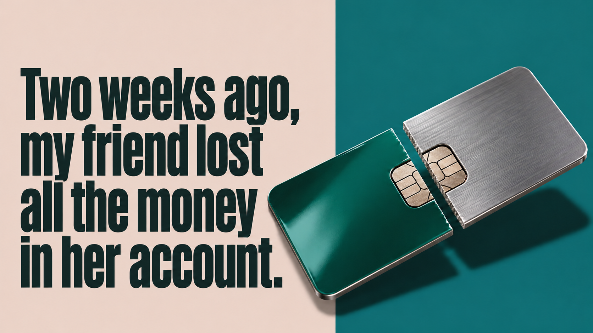

<!--
SLIDE 1 · 0:00–0:25
“Two weeks ago, my friend got scammed through a website that looked like a payment gateway. She told me it took all the money out of her account. I don’t want that to happen to me, and I know you don’t want it to happen to you either.”
Pause on the image. This is the friend’s reported experience. The later bill, SMS and caller are fictional examples. The alternate logo-free covers are split-card-chestnut.png and split-card-slate.png in the same folder.
-->

---

## It looked like a payment gateway

`www[.]dilmunexpress[.]site`

**When could someone have warned her?**

<!--
SLIDE 2 · 0:25–0:42
“This is the address she shared with me. Imagine seeing it on your phone when you’re already expecting a payment request. What could help you decide before you type your card details?”
Keep the reported address as plain text. The team has not independently investigated the incident.
-->

---

## Three places Haris can help

1. **Chrome extension** · Spot a page asking for payment or a one-time code.
2. **Mobile app / Calls** · Hear when someone asks you to read out that code.
3. **Mobile app / SMS** · Check where a billing text wants to take you.

<!--
SLIDE 3 · 0:42–1:00
“One Chrome extension and one React Native app with two sections. You might first encounter a scam in any of these places. Each check should help on its own.”
-->

---

## How Chrome spots a payment request

1. A **Manifest V3 content script** checks visible labels, buttons and field types. A `MutationObserver` catches a checkout or code field that appears later.
2. As soon as it sees a payment or code prompt, Haris **shows a notice**. Local rules compare the site and payment host with the operator’s listed billing partners.
3. A mismatch triggers **“This gateway isn’t listed for your operator.”** The customer can leave and open official billing.

<!--
SLIDE 4 · 1:00–1:38
“The cue appears before you type. We can recognise a one-time-code field from its label or autocomplete metadata. We never need the code itself. Genuine checkouts still get a quiet cue. An unknown merchant or a frame the extension lacks permission to inspect gives an unverified result.”
-->

---

## How the app hears a code request

1. The **Calls** section feeds a consented audio sample to a bundled multilingual Whisper model through **whisper.rn**.
2. On the phone, bilingual rules examine the transcript. In “عشان نحل المشكلة، عطنا الـ OTP”, the phrase **“عطنا الـ OTP”** triggers the warning.
3. The customer sees **“They’re asking you to read out your login code.”** Haris masks spoken digits and clears the transcript when the session ends.

<!--
SLIDE 5 · 1:38–2:15
“Speech recognition transcribes what was said. Rules distinguish asking for the code from advice to keep it private. A recorded support call is the hackathon input. Live calls inside an operator’s app would be an opt-in pilot. Ordinary cellular-call audio requires platform or operator support.”
-->

---

## How the app checks an SMS link

1. Share or paste the message into **SMS**. React Native passes the selected text to local TypeScript rules that find the payment request and extract the hostname.
2. Haris compares the hostname with a **bundled billing directory**. For the example link, a saved page preview also reveals a card-entry form.
3. Haris shows the mismatch and offers **Open official billing**. An unfamiliar link or unresolved redirect gets **“Couldn’t verify.”**

<!--
SLIDE 6 · 2:15–2:50
“Our example asks for BD 1.500. That sounds plausible. The useful evidence is that the named operator and gateway do not match. The saved preview belongs to the fictional example. An offline phone cannot see the contents of a previously unseen website. Opening the operator’s official site is a separate customer action.”
-->

---

<!-- _class: dark -->

## The operator supplies the directory. The phone runs the check.

Chrome and the app use the same **TypeScript rules and billing records**.

The mobile design keeps selected messages, URLs, audio and transcripts on the device during analysis.

<!--
SLIDE 7 · 2:50–3:20
“One operator can tell us which domains and payment partners it uses. Chrome checks what is on the current page. The app can check a message or transcribe supported audio offline. We can test this in airplane mode, then check network traffic when connected and after reconnecting. Those are proposed privacy tests, not measured results.”
-->

---

## The first telecom pilot

**One operator** supplies its billing domains and approved processors.

**Customers of different ages** try a genuine bill, a fake gateway and a caller asking for a code.

**We measure** whether the warning arrives before disclosure and whether customers can still pay the genuine bill.

<!--
SLIDE 8 · 3:20–3:55
“I keep thinking about the moment before my friend typed in her details. Help us test whether Haris can give someone enough information, in that moment, to make a different choice.”
Next steps after a pilot would be opt-in calls inside the operator app and evaluation of Gulf Arabic speech. Report outcomes only after testing.
-->

<!--
REHEARSAL NOTES · Eight slides, approximately 3 minutes 55 seconds. Speaker 1 can tell the story and close. Speaker 2 can explain the three checks on slides 4–6.

What we borrowed from winning presentations
• Argus, 2025 Microsoft Imagine Cup World Champion. Microsoft documented the founders’ grandparents’ experiences, showed the physical prototype and published its final pitch. We adapted the personal origin and the visible demonstration. Here, the observable result is a warning appearing while the presenter’s hands are still off the keyboard. Microsoft's stage photo and account: https://blogs.microsoft.com/bayarea/2025/05/13/stanford-students-vie-to-win-the-2025-imagine-cup-with-a-device-to-help-people-with-low-vision/ . Official final pitch: https://www.youtube.com/watch?v=oAYnlvZD92Q .
• Scamoorai, Most Life-Changing Idea, Singapore’s Hackathon for a Better World 2022. The organisers published the winning pitch summary and the team’s reflection on focusing on a customer pain point. Their app/web concept included call and text detection. Our deck follows one payment request across three places and shows where customers can go after each alert. Organisers’ account, Annex A: https://www.judiciary.gov.sg/news-and-resources/news/news-details/joint-media-release-dbs-singapore-courts-and-national-crime-prevention-council-announce-winners-of-community-hackathon-to-find-solutions-that-foster-a-scam-resilient-society .
• Local relevance: Bahrain TRA and operators’ fraudulent-SMS initiative: https://www.tra.org.bh/en/en/article/tra-bahrain-and-mobile-operators-launch-guidelines-to-combat-fraudulent-sms .

For judges’ questions
• How do you know a site is fake? A payment field triggers the first notice. A known threat or a specific mismatch raises severity. A new merchant, an expired record or a redirect we cannot safely resolve stays unverified. A recognised processor alone cannot establish a merchant’s identity.
• Can a malicious message fool the AI? Treat all external text as data. Speech recognition and local phrase matching supply evidence. Fixed rules decide the warning. Official routes come from a separate directory. In the demo the model has no browser, payment or messaging tools.
• How do you check the linked site? Inspect a locally stored page preview in the demo. When the local directory and stored preview cannot establish a destination, show “Couldn’t verify.” The phone does not send the link to a remote scanner. A new live webpage needs a connection to inspect.
• What if I wish to pay? Open the merchant or operator app independently. A genuine checkout still gets the quiet cue. Check that people can finish genuine tasks as part of the pilot.
• What exists today? These slides describe the proposed prototype. When presenting, demo the pieces that actually run and label every fixture, simulated input and fallback.
-->
